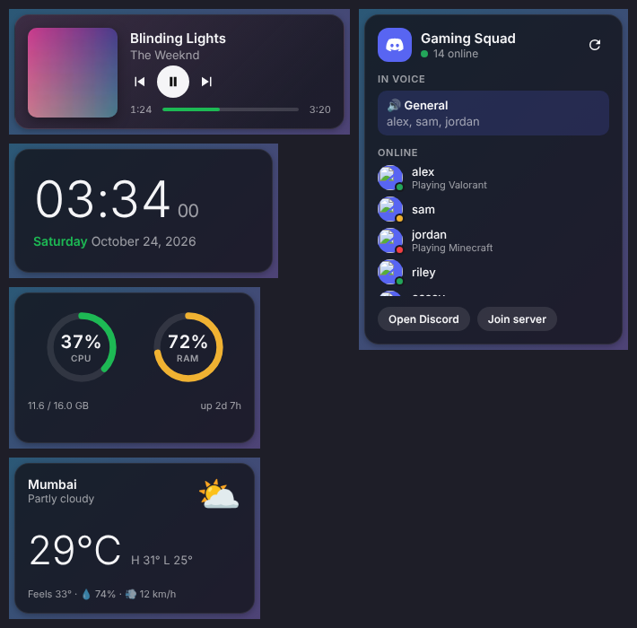

# Desktop Widgets for Windows

Small, draggable widgets that sit on your Windows desktop:

| Widget | What it shows | Setup |
| --- | --- | --- |
| **Spotify** | Album art, title, artist, progress bar, previous / play-pause / next | None. Just have the Spotify desktop app open. |
| **Discord** | Your server's name, online count, who's in voice, online members and what they're playing | Paste your server ID into the settings (see below). |
| **Clock** | Time and date | Optional 12/24-hour and seconds. |
| **System** | CPU and RAM usage, uptime | None. |
| **Weather** | Current temperature, conditions, high/low, humidity, wind | Set your city. |



## Install and run

You need [Node.js](https://nodejs.org) 20 or newer.

```powershell
git clone https://github.com/Shlokvenga/Windows-widgets.git
cd Windows-widgets
npm install
npm start
```

The widgets appear down the right-hand side of your screen and an icon appears in the system tray.

### Build an .exe

```powershell
npm run dist
```

This creates a portable `.exe` and an installer in `dist/`.

## Using the widgets

- **Move:** drag a widget anywhere. Its position is remembered.
- **Tray icon:** right-click it to:
  - turn individual widgets on or off
  - **Lock positions** (stops accidental dragging)
  - keep widgets **Always on top**
  - **Start with Windows**
  - **Reset positions**, **Edit settings…**, **Reload widgets**, **Quit**
- Click a song title to open Spotify. Use the buttons on the Discord widget to open Discord or join the server.

By default, widgets sit behind your other windows, like desktop icons. Turn on **Always on top** if you'd rather they float above everything.

## Settings

Choose **Edit settings…** from the tray menu. This opens `config.json` (in `%APPDATA%\Desktop Widgets\`). Save the file and the widgets reload automatically.

```jsonc
{
  "alwaysOnTop": false,
  "locked": false,
  "theme": {
    "accent": "#1db954",                    // progress bars, highlights
    "background": "rgba(18, 18, 24, 0.78)", // the last number is opacity
    "text": "#f5f5f7",
    "radius": 16                             // corner roundness
  },
  "widgets": {
    "spotify": { "enabled": true, "source": "Spotify", "dynamicColor": true },
    "discord": { "enabled": true, "serverId": "", "refreshSeconds": 60, "maxMembers": 8 },
    "clock":   { "enabled": true, "hour12": false, "showSeconds": true },
    "system":  { "enabled": true },
    "weather": { "enabled": true, "city": "London", "latitude": null, "longitude": null,
                 "units": "celsius", "refreshMinutes": 15 }
  }
}
```

### Spotify

The Spotify widget reads the same "now playing" info that Windows shows in the volume pop-up. It uses Windows' built-in media controls (through a small PowerShell helper), so there's no Spotify login or API key.

- `source` is matched against the app that's playing. Set it to `""` to follow whatever is playing (YouTube in a browser, Apple Music, etc.). You can also name another app, such as `"Chrome"`.
- `dynamicColor` tints the widget to match the album art.

### Discord

The Discord widget uses Discord's official **server widget**, so it needs no bot or token. To set it up:

1. In Discord, open **Server Settings → Widget** and turn on **Enable Server Widget**. You need the *Manage Server* permission.
2. On the same page, copy the **Server ID**.
3. Paste it into `widgets.discord.serverId` in the settings.
4. Optional: pick an **Invite Channel** on that page to show a **Join server** button.

> Discord doesn't let third-party apps read your personal DMs, unread messages or friends list without breaking its terms of service. The widget therefore shows server activity instead.

### Weather

Weather comes from [Open-Meteo](https://open-meteo.com), which is free and needs no key. Set `city`, or set `latitude` and `longitude` for an exact spot. Set `units` to `"fahrenheit"` for °F and mph.

## Adding your own widget

1. Create `src/widgets/<name>/index.html`. Include `../common.css` and `../common.js`, and call `await setupWidget('<name>')` to apply the theme and get your settings.
2. Add the widget's size to the `WIDGETS` table in `src/main.js`.
3. Add a `"<name>": { "enabled": true }` entry to `src/default-config.json`.
4. If the widget needs data from the internet or the PC, add a function in `src/services/`. Register it with `ipcMain.handle` in `main.js` and expose it in `src/preload.js`. Widget pages are sandboxed and can't use Node directly.

## Project layout

```
src/
  main.js               windows, tray menu, settings, IPC
  preload.js            the safe API widgets can call (window.widgets)
  default-config.json
  media/                Spotify / now-playing bridge (PowerShell + Node)
  services/             Discord, weather and system data
  widgets/              one folder per widget (HTML/CSS/JS)
```
